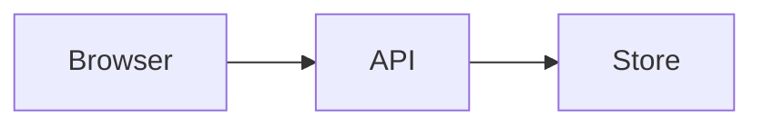

# Rich Technical Content

Pagenary renders inline LaTeX, complete `.tex` pages, Mermaid diagrams, and
PlantUML diagrams without depending on a public rendering service. This guide
describes the supported authoring syntax, local tool requirements, and the
security limits that remain in force for tenant content.

## Inline LaTeX

“Inline LaTeX” is Pagenary's name for math embedded in Markdown. It is rendered
at build time by the pinned KaTeX dependency and emitted as HTML plus MathML.
The generated site includes KaTeX CSS and fonts locally, so math works offline
and remains available to assistive technology, snapshots, search, and export.

Use `\(...\)` for inline math and either `\[...\]` or `$$...$$` for display
math:

```markdown
Euler's identity is \(e^{i\pi}+1=0\).

\[
  \int_0^1 x^2\,dx = \frac{1}{3}
\]

$$\mathbf{A}\vec{x}=\vec{b}$$
```

The expression inside a delimiter may use the full syntax supported by the
pinned KaTeX release (`0.18.1`). “Full LaTeX” here means KaTeX's math-language
surface, not arbitrary TeX execution: document commands, package loading,
filesystem access, shell escape, and unsupported KaTeX commands are not part of
inline LaTeX.

Single-dollar delimiters are off by default so prices such as `$20` are not
mistaken for math. Opt in for a tenant or override the setting in a Markdown
page's frontmatter:

```json
{
  "inlineLatex": {
    "dollarDelimiters": true
  }
}
```

```markdown
---
inlineLatex:
  dollarDelimiters: true
---

Now $x+1$ is math.
```

Inline LaTeX is deliberately ignored inside fenced code, inline code, HTML
elements and comments, and Markdown link destinations. Escaping the opening
delimiter also leaves it literal. It may still be used in normal prose,
headings, lists, tables, quotations, and link labels.

### Bounds and macros

```json
{
  "inlineLatex": {
    "enabled": true,
    "throwOnError": false,
    "maxSize": 20,
    "maxExpand": 1000,
    "macros": {
      "\\RR": "\\mathbb{R}",
      "\\vect": "\\mathbf{#1}"
    }
  }
}
```

`maxSize` is clamped to 1–100 and `maxExpand` to 0–10,000. Macros are copied
for each page render; definitions do not leak between pages. KaTeX `trust`
remains false and cannot be enabled by tenant configuration. With
`throwOnError: false`, invalid input produces a visible KaTeX error form and a
warning diagnostic. With `true`, it is retained as authored and produces an
error diagnostic for build enforcement.

## Complete LaTeX pages (`.tex`)

A manifest entry may point directly to a `.tex` file:

```json
[
  {
    "id": "theory",
    "title": "Theory",
    "file": "theory.tex",
    "contentType": "latexPage"
  }
]
```

Pagenary converts it to semantic HTML and MathML during the build. A `.tex`
page is a distinct content type; it is not Markdown with broader math
delimiters. Explicit manifests must declare `contentType: "latexPage"`; a
mismatched type or an undeclared `.tex` page fails validation. Safe filesystem
discovery assigns this type automatically. The selected converter must already
be installed locally:

- `standard-web-v1` (default) invokes `latexmlc`. It is the standard semantic
  web profile.
- `portable-subset-v1` invokes `pandoc --from=latex --to=html5 --mathml`. It is
  explicitly a portable subset and is not a substitute for arbitrary package
  or macro compatibility.
- `pdf-v1` invokes Tectonic as an optional sibling artifact. It adds a
  content-addressed download link but never replaces the semantic HTML page.

```json
{
  "latexPage": {
    "profile": "standard-web-v1",
    "failurePolicy": "strict",
    "allowedPackages": ["amsmath", "amssymb", "graphicx"],
    "timeoutMs": 20000,
    "maxOutputBytes": 4194304,
    "pdf": {
      "enabled": true,
      "profile": "pdf-v1",
      "failurePolicy": "warn",
      "maxPdfBytes": 16777216
    }
  }
}
```

The default package allowlist is `amsmath`, `amssymb`, `array`, `booktabs`,
`graphicx`, `hyperref`, `inputenc`, `mathtools`, `microtype`, `textcomp`, `url`, and
`xcolor`. Setting `allowedPackages` replaces that list for the tenant. Included
TeX, bibliography, and graphic files must exist beneath the tenant content
root. Absolute paths, parent traversal, URLs, pipe input, direct TeX file I/O,
shell escape, and unsafe packages are rejected before the converter runs.

The converter receives a bounded timeout/output buffer, a content-root working
directory, a deterministic epoch, and a restricted environment. Pagenary does
not install converters or TeX packages during a build. Converter availability
alone does not imply that every LaTeX document or CTAN package has been
qualified.

`failurePolicy` has three values: `warn` (default) emits escaped source fallback
and diagnostics, `strict` fails rendering, and `off` emits no fallback content.
Use `strict` in release builds where loss of semantic page content is not
acceptable.

Optional PDF generation requires local Tectonic with its bundle already
cached. Pagenary invokes it with `--untrusted --only-cached`; no package download
is allowed during the build. `pdf.failurePolicy: "warn"` retains the HTML page
without a PDF link when Tectonic is unavailable, while `strict` fails the build.

## Mermaid

Author Mermaid in a fenced block. An optional quoted title is used as the
build-rendered figure caption:

````markdown

````

The default `runtime` mode lazily loads the exact locally vendored Mermaid
`11.16.0` browser bundle only when a page contains a diagram. It makes no CDN or
network request and works with an offline deployment. The runtime uses strict
security, text/edge bounds, HTML labels disabled, and deterministic IDs. If the
local bundle cannot load or a definition fails, the authored code remains
visible with an error message.

Set build mode to generate sanitized SVG while publishing:

```json
{
  "richContent": {
    "failurePolicy": "warn",
    "mermaid": {
      "mode": "build",
      "theme": "neutral",
      "executablePath": "/opt/mermaid-cli/node_modules/.bin/mmdc",
      "browserPath": "/opt/puppeteer-cache/chrome-headless-shell/linux-139.0.7258.66/chrome-headless-shell-linux64/chrome-headless-shell",
      "timeoutMs": 20000,
      "fonts": ["DejaVu Sans"],
      "maxSourceBytes": 50000,
      "maxEdges": 500,
      "maxOutputBytes": 4194304
    }
  }
}
```

Build mode uses the lockfile-backed `@mermaid-js/mermaid-cli` 11.16.0 and
Puppeteer 24.16.0 qualification toolchain. Both executable paths are explicit
operator configuration; content cannot select a command. Rendering runs as a
bounded subprocess with a scrubbed environment, fixed classic rendering and
hand-drawn seed, strict Mermaid security, and no remote service. The cache key
includes source, Mermaid/CLI version, secured configuration, theme, declared
fonts, and SVG output format. Sanitized output is stored as an immutable local
`assets/rich-content/mermaid/<digest>.svg` asset. If the toolchain is
unavailable, `warn` preserves escaped source with diagnostics and `strict`
fails the build. The figure retains its caption and original source disclosure
for accessibility and troubleshooting.

Choose `runtime` when interactive pan/zoom and the smallest publish-time
toolchain matter most. Choose `build` for script-free CSP, static/offline
delivery, crawlers, snapshots, and exports. Migration requires installing the
qualified image/toolchain, setting the two absolute executable paths, declaring
the theme/fonts used by the deployment, and changing only `mode` to `build`;
fence syntax, titles, captions, search text, source fallback, and accessible
names remain the same.

## PlantUML

PlantUML is build-time and local-only:

````markdown
```plantuml
Alice -> Bob: hello
```
````

For an ordinary UML fence, Pagenary supplies `@startuml`/`@enduml` when they
are omitted. Explicit matching families such as `@startjson`/`@endjson` and
`@startyaml`/`@endyaml` are preserved; mismatched wrappers fail validation.

Configure either an absolute PlantUML executable path or an absolute JAR and
Java path. Paths are operator configuration, not content-controlled commands:

```json
{
  "richContent": {
    "failurePolicy": "strict",
    "plantuml": {
      "enabled": true,
      "executablePath": "/opt/plantuml/bin/plantuml",
      "version": "1.2026.4",
      "includeProfile": "OFF",
      "graphvizVersion": "2.42.2",
      "fonts": ["DejaVu Sans"],
      "toolchainDigest": "sha256:eeeb2887f90fbca52c03e96ec13a05a3138b8661fc437a72ab1e08822f071b57",
      "pngFallback": false,
      "maxSourceBytes": 131072,
      "maxIncludes": 32,
      "maxOutputBytes": 4194304
    }
  }
}
```

```json
{
  "richContent": {
    "plantuml": {
      "jarPath": "/opt/plantuml/plantuml.jar",
      "javaPath": "/usr/bin/java"
    }
  }
}
```

Pagenary always forces `PLANTUML_SECURITY_PROFILE=SANDBOX` (including the JVM
system property for JAR execution), uses a scrubbed environment and bounded
subprocess, and sanitizes SVG output. URL/import directives are forbidden.
Local includes are disabled by default. Set `includeProfile: "ALLOWLIST"` only
when `!include` or `!include_once` is required; every included file must remain
beneath the tenant root and is dependency-hashed for cache invalidation. Cycles,
symlink escapes, traversal, and excessive includes are rejected. The publisher never falls back to
a PlantUML server. Sanitized SVG is emitted as a content-addressed tenant asset
and referenced by accessible image markup, rather than injected inline. When no configured local tool is available, `warn` retains
escaped source and diagnostics while `strict` fails the build.
Set `pngFallback: true` to emit a content-addressed PNG fallback inside a
`picture` element while retaining SVG as the preferred source. Both generated
files are subject to `maxOutputBytes`.

## Delivery behavior

Semantic text from rich content feeds the same page snapshots, Fortemi search
corpus, `llms.txt`/LLM-readable artifacts, and whole-site export paths as other
page content. Inline LaTeX carries MathML; build-rendered diagrams retain a text
caption or source fallback. Runtime Mermaid needs JavaScript for the SVG, but
its source remains part of authored content and failures remain inspectable.
All shipped KaTeX and Mermaid assets are local, so these features do not add a
public CDN dependency.

## Troubleshooting and diagnostics

When a render fails, first inspect build diagnostics for its stable code and
renderer name. Common causes are:

- `INLINE_LATEX_RENDER_FAILED`: malformed or unsupported KaTeX syntax, or a
  size/expansion bound.
- `LATEX_RENDERER_UNAVAILABLE`: the selected `latexmlc` or `pandoc` executable
  is absent from the build environment.
- `LATEX_PACKAGE_NOT_ALLOWED` or `LATEX_DEPENDENCY_*`: a package or referenced
  file failed preflight.
- Mermaid source/edge/output-limit or unavailable-DOM diagnostics in build
  mode.
- `RTC_PLANTUML_UNAVAILABLE` or `RTC_PLANTUML_INCLUDE_*`: the configured local
  tool or a contained include failed validation.

Run `pagenary doctor` (or `pagenary doctor --json` in automation) to report the
bundled KaTeX/Mermaid versions and PATH-based converter, PlantUML, and Java
availability. Doctor performs capability/version checks, not a document render;
it does not download tools, weaken sandboxing, or certify documents outside the
tested corpus. An absolute PlantUML path configured for a tenant may therefore
work even when the PATH-based doctor check says `plantuml` was not found. Keep
`failurePolicy: strict` in CI, pin operator tools, and reproduce with the same
tenant configuration when diagnosing a release build.
