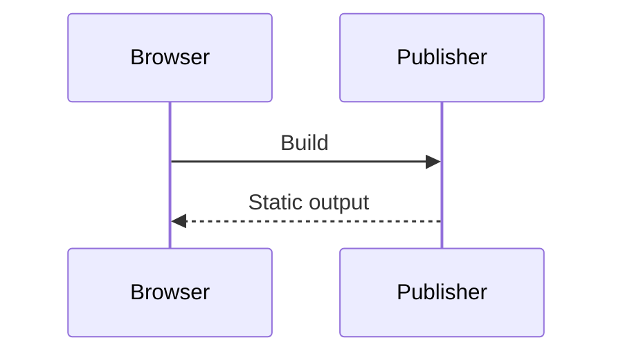
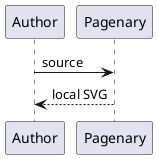

# Supported syntax reference

This is the help-base index for Pagenary authoring syntax. Its executable companion is the
[syntax gallery](https://docs.pagenary.com/syntax-gallery/) tenant. The machine-readable
[syntax inventory](https://git.integrolabs.net/roctinam/pagenary/src/branch/main/apps/publisher/examples/syntax-gallery/syntax-inventory.json) maps each supported feature
to both an example and a section here; CI rejects missing files, anchors, duplicate IDs, and undocumented
inventory entries.

“Supported” means the syntax is recognized by Pagenary. It does not mean every feature is self-contained:
hosted media and hosted forms intentionally contact their named provider, while PlantUML and complete
LaTeX pages require local tools for full rendering. Their bounded warning fallbacks keep the gallery
buildable when optional tools are absent.

## Markdown blocks

Runnable gallery: [Markdown](https://docs.pagenary.com/syntax-gallery/#markdown).

The built-in Markdown renderer supports ATX headings (`#` through `######`), soft-wrapped paragraphs,
unordered lists using `-`, `*`, or `+`, block quotations beginning with `>`, pipe tables with optional
left/center/right alignment markers, and horizontal rules made from at least three `-`, `*`, or `_`
characters. Ordered lists, task lists, definition lists, and footnotes are not currently implemented by
the built-in renderer and should not be presented as supported syntax.

```markdown
# Heading

A paragraph with a soft-wrapped
continuation.

- First item
- Second item

> A quotation

| Name | Value |
| :--- | ---: |
| Alpha | 1 |

---
```

## Inline Markdown

Runnable gallery: [Markdown](https://docs.pagenary.com/syntax-gallery/#markdown).

Use `**strong**`, `*emphasis*` or `_emphasis_`, and backticks for inline code. A deliberately narrow raw
HTML exception, `<span title="…">text</span>`, provides tooltips. Other raw HTML in prose is escaped; use
the explicit HTML fence only for trusted author content.

```markdown
Use **strong**, *asterisk emphasis*, _underscore emphasis_, `inline code`,
and <span title="Extra context">a tooltip</span>.
```

## Links and images

Runnable gallery: [Markdown](https://docs.pagenary.com/syntax-gallery/#markdown).

Pagenary supports `[label](target)`, ``, `<https://example.com>`, `<mailto:name@example.com>`,
and bare HTTP(S) URLs. External links receive safe new-tab attributes. Internal Markdown paths are
validated and transformed into site routes. `@docs/path.md` resolves a document mention; unresolved
`@docs/` and all `@.aiwg/` references render as inline code. Put `{zoom}` immediately after a standalone
SVG, PNG, or JPEG Markdown image to opt into the accessible image viewport.

```markdown
[Rich content](RICH-CONTENT.md) · <https://example.com> · @docs/RICH-CONTENT.md

{zoom}
```

## Special fences

Runnable galleries: [Markdown](https://docs.pagenary.com/syntax-gallery/#markdown) and
[page primitives](https://docs.pagenary.com/syntax-gallery/#page-primitives).

An ordinary triple-backtick fence produces escaped code and accepts a language label for syntax
highlighting. ```` ```box ```` and ```` ```box:Title ```` produce an escaped panel. ```` ```html ````
emits trusted raw HTML. HTML comments outside code fences are removed from published content. Renderer,
media, and form fences are described below.

````markdown
```js
const answer = 42;
```

```box:Important
Panel text is escaped.
```

```html
<aside class="callout">Trusted author HTML</aside>
```
````

## Page frontmatter

Runnable gallery: [Page primitives](https://docs.pagenary.com/syntax-gallery/#page-primitives).

A leading YAML frontmatter block supports scalars, nested maps, block lists, and inline flow maps/lists.
Common page keys include `title`, `summary`, `template`, page-scoped `inlineLatex` and `media` controls,
and declarative `hero` and `banner` maps. A hero can set eyebrow, title, subtitle, image, alignment,
overlay, full-bleed, parallax, and sticky behavior. A banner can contain a CTA list whose entries have
`label`, `href`, and `style`. See [Page effects](PAGE-EFFECTS.md) and [Tenant configuration](TENANT-CONFIG.md)
for the complete configuration context.

```yaml
---
title: Example page
summary: A copyable page configuration
hero:
  eyebrow: Guide
  title: Start here
banner:
  title: Ready?
  ctas:
    - { label: "Continue", href: "#next", style: primary }
---
```

## Inline LaTeX

Runnable gallery: [Inline LaTeX](https://docs.pagenary.com/syntax-gallery/#inline-latex).

Inline LaTeX uses the pinned KaTeX math-language surface. Use `\(...\)` inline and `\[...\]` or `$$...$$`
for display math. Single-dollar `$...$` is a page- or tenant-level opt-in. Tenant macros are copied into
each page render, and page overrides do not leak. Math is ignored in code, raw HTML, comments, and link
destinations. `trust` is always false; expansion and size limits remain bounded. See
[Rich technical content](RICH-CONTENT.md#inline-latex) for every option and failure behavior.

```markdown
Inline: \(\vec{x}\in\mathbb{R}^n\)

\[
  \int_0^1 x^2\,dx = \frac{1}{3}
\]
```

The gallery also demonstrates aligned environments, tenant macros, optional
single-dollar delimiters, and protected code/link contexts. “Inline LaTeX”
means the complete math-language surface accepted by the pinned KaTeX version,
subject to trust, expansion, and source-size bounds—not a reduced notation list.

## Diagrams

Runnable gallery: [Diagrams](https://docs.pagenary.com/syntax-gallery/#diagrams).

A `mermaid` fence creates a Mermaid diagram. Runtime mode loads the exact locally vendored Mermaid bundle
only when needed; build mode emits sanitized SVG when its DOM-capable environment is available. A
`plantuml` or `puml` fence invokes a configured local executable or JAR under the sandbox profile. Both
support bounded source/output and diagnostics; neither requires or silently falls back to a public
rendering service. See [Rich technical content](RICH-CONTENT.md#mermaid).

````markdown



````

The gallery exercises Mermaid flowchart, sequence, class, state, and ER syntax,
and PlantUML sequence, class, component, activity, state, ER, JSON, and YAML
families. Source defaults are 50,000 bytes and 500 Mermaid edges; generated SVG
is bounded to 1 MiB. PlantUML uses the documented source/include/output limits.

## Media

Runnable gallery: [Media and forms](https://docs.pagenary.com/syntax-gallery/#media-forms).

A `media` fence accepts either simple `key: value` lines or JSON. Supported types are:

- `image`/`picture`/`img`, including portrait and landscape sources, alt text, caption, long description,
  dimensions, eager/lazy loading, download, and the bounded accessible viewport;
- `audio`/`podcast`/`narration`, using the native audio player with caption, download, and transcript;
- `video`, using the native video player with poster and caption-track fields; and
- `embed`, `youtube`, `vimeo`, or `peertube`, privacy-gated by default and restricted by the page/tenant
provider allowlist.

````markdown
```media
type: image
src: assets/chart.webp
alt: Quarterly revenue rises from Q1 through Q4
caption: Revenue by quarter
```

```media
{"type":"audio","src":"assets/episode.mp3","transcript":"assets/episode.txt"}
```
````

Local media is compatible with offline output. Hosted media is network-dependent by definition and emits
a deliberate activation control plus fallback link rather than loading an iframe immediately.

## Forms

Runnable gallery: [Media and forms](https://docs.pagenary.com/syntax-gallery/#media-forms).

A `tally` fence supports `id`, `mode` (`inline` or `popup`), `button`, and `title`. It emits a static hosted
fallback and progressively enhances only when used. The form ID is public authoring data, never a secret.
Tally is currently the only registered provider and requires its documented CSP/network allowance.

````markdown
```tally
id: public-form-id
mode: popup
button: Open feedback form
title: Feedback
```
````

## Complete LaTeX pages

Runnable gallery: [Complete LaTeX page](https://docs.pagenary.com/syntax-gallery/#latex-page).

A manifest may point directly to a `.tex` file, making converted LaTeX the rendered page content rather
than embedding it in Markdown. The standard web profile uses local LaTeXML; the portable subset uses
local Pandoc with HTML5 and MathML. Preflight rejects unsafe packages, file I/O, traversal, URLs, and shell
escape before a bounded converter process runs. `warn` preserves escaped source when a converter is
absent, while `strict` fails the build. See [Rich technical content](RICH-CONTENT.md#complete-latex-pages-tex).

```json
{
  "id": "theory",
  "title": "Theory",
  "file": "theory.tex",
  "contentType": "latexPage"
}
```

Explicit manifests require `contentType: "latexPage"`; filesystem discovery
assigns it automatically for safely contained `.tex` files.

```json
{
  "latexPage": {
    "profile": "standard-web-v1",
    "failurePolicy": "strict",
    "pdf": { "enabled": true, "profile": "pdf-v1" }
  }
}
```

The `.tex` file is the page source itself; it is not embedded in Markdown.
HTML/MathML remains the primary accessible page. Optional Tectonic PDF is a
sibling download and never replaces the HTML page. The standard profile applies
20-second and 4-MiB process-stream defaults, package/path preflight, a scrubbed
environment, and external network/process/container bounds.

## Network and offline behavior

Markdown, local images/media, inline LaTeX, Mermaid runtime rendering, and successfully converted diagrams
and LaTeX pages use local assets. Only explicitly hosted features—hosted media and forms—need public
network access. The gallery labels those exceptions so an offline audit can distinguish an intentional
provider URL from an accidental CDN dependency.
