# Diagrams

Every diagram has a human-readable title and retains its source as fallback text.
The gallery uses the pinned local Mermaid runtime and never calls a rendering CDN.

## Mermaid families

### Mermaid flowchart

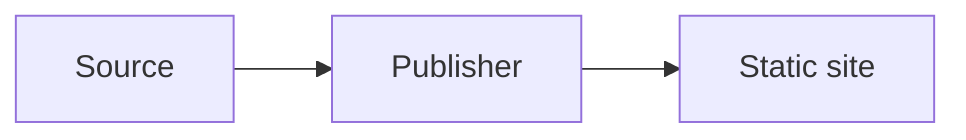

### Mermaid sequence

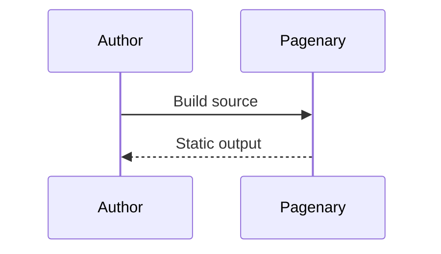

### Mermaid class

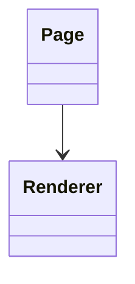

### Mermaid state

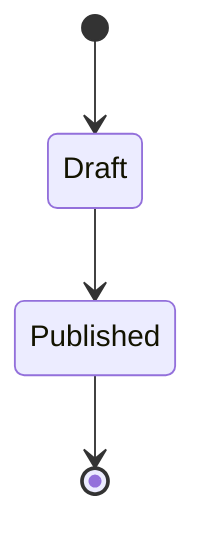

### Mermaid ER

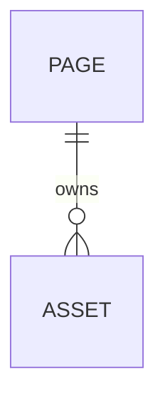

## PlantUML families

PlantUML is optional local software. With this gallery's `warn` policy, a machine
without it preserves source and reports the unavailable renderer without a network
request. The examples below cover every qualified family.

### PlantUML sequence

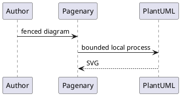

### PlantUML class

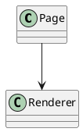

### PlantUML component

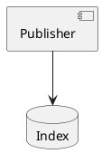

### PlantUML activity

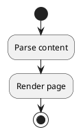

### PlantUML state

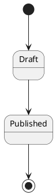

### PlantUML ER

```plantuml title="Entity relationship: local assets"
@startuml
entity Page { * id : string }
entity Asset { * path : string }
Page ||--o{ Asset
@enduml
```

### PlantUML JSON

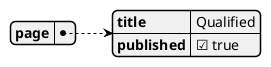

### PlantUML YAML

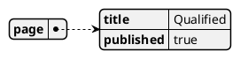

### puml alias and omitted wrapper

The shorter fence name is equivalent. For UML-family source, omitted
`@startuml`/`@enduml` wrappers are synthesized safely:

```puml title="Alias: synthesized UML wrapper"
Publisher -> Output: static assets
```

## Bounds and fallback

Mermaid source is limited to 50,000 bytes and 500 estimated edges; build SVG is
bounded to 1 MiB by default. PlantUML applies configured source, include-count,
include-byte, SVG, and optional PNG limits. `warn` emits escaped source with a
diagnostic, `strict` fails the build, and `off` omits failed output. Generated SVG
is sanitized and content-addressed before publication.
