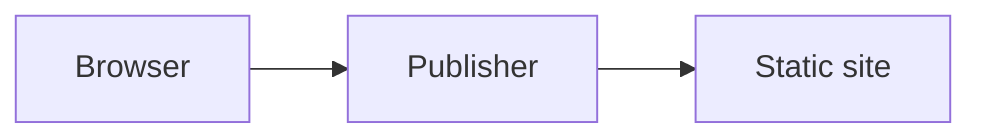
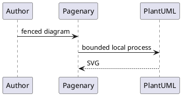
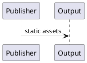

# Diagrams

## Mermaid

Mermaid uses the pinned local browser bundle in the default runtime mode; it does not call a CDN.

## PlantUML

PlantUML is optional software. With this gallery's `warn` policy, a machine without it preserves the
source and reports the missing renderer instead of making a network request.

The shorter fence name is an equivalent alias:

