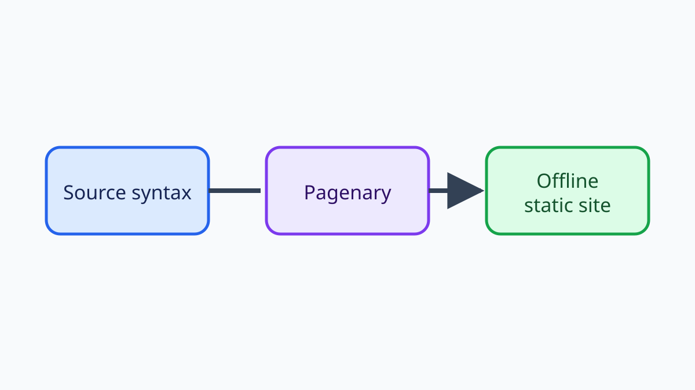

# Markdown syntax

## Headings and inline text

Pagenary supports headings one through six, ordinary paragraphs, **strong text**, *asterisk emphasis*,
_underscore emphasis_, and `inline code`. A tooltip can be authored as
<span title="Extra context without obscuring the prose">hoverable context</span>.

## Links, mentions, and images

Use [internal links](#tables), [external links](https://example.com), angle autolinks
<https://example.com/reference>, email autolinks <mailto:docs@example.com>, and bare URLs such as
https://example.com/status. A resolvable document mention looks like @docs/markdown.md; references outside
the published corpus, such as @.aiwg/requirements/example.md, render as code.



{zoom}

## Lists and quotations

- Unordered lists accept hyphens.
* Asterisks work too.
+ So do plus signs.

> Block quotations preserve inline **emphasis** and links.

## Tables

| Construct | Support | Alignment |
| :--- | :---: | ---: |
| headings | yes | 6 levels |
| tables | yes | left, center, right |

---

## Code fences

```js
const message = '<HTML is escaped in ordinary code>';
```

```box:Bounded note
Box fences display preformatted, escaped content in a titled panel.
```
